  

I help remote teams around the world ship web and mobile apps their users can trust.

  
  
  

  

### ⚡ How I test

- 🔍 **Manual and exploratory:** functional, regression, smoke, cross-browser, API, Android and iOS. I go beyond the happy path to edge cases, permissions and error handling.
- 🎭 **Automation:** end-to-end tests with Playwright, built with AI help, with parallel runs and saved logins.
- 🤖 **My own AI QA workflow:** I built a Claude Code + Playwright workflow that reads a test task, writes test cases ranked by risk, runs them, and drafts the bug report with screenshots for me to review.

### 🌍 Remote-ready

- Working with international teams across time zones, from Bangladesh (GMT+6)
- Async-first: bug reports a developer can act on without a call, with steps, expected vs actual, screenshots and video
- Open to remote QA roles

### 🛠️ Toolbox

### 📫 Let's work together

**Email:** [sabbir.hossin.qa@gmail.com](mailto:sabbir.hossin.qa@gmail.com) · **Portfolio:** [sabbir-portfolio-qa.vercel.app](https://sabbir-portfolio-qa.vercel.app/) · **LinkedIn:** [in/sabbir88](https://www.linkedin.com/in/sabbir88/)

<i>"I test the way I ride: one careful decision at a time." 🏍️</i>

